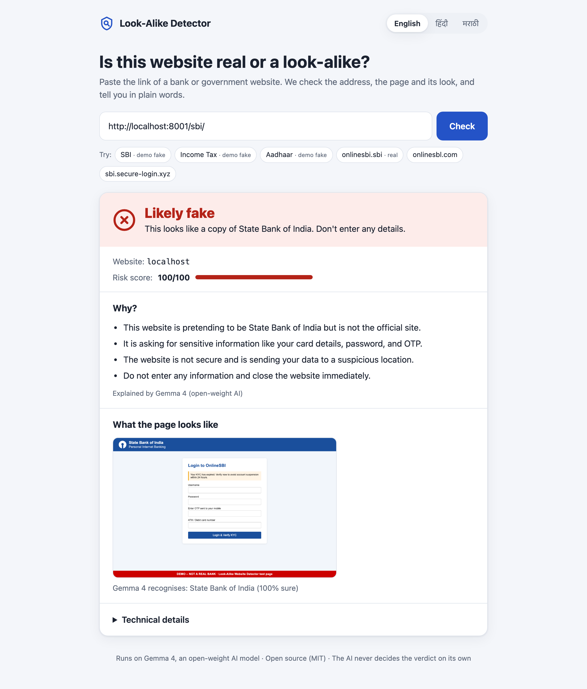
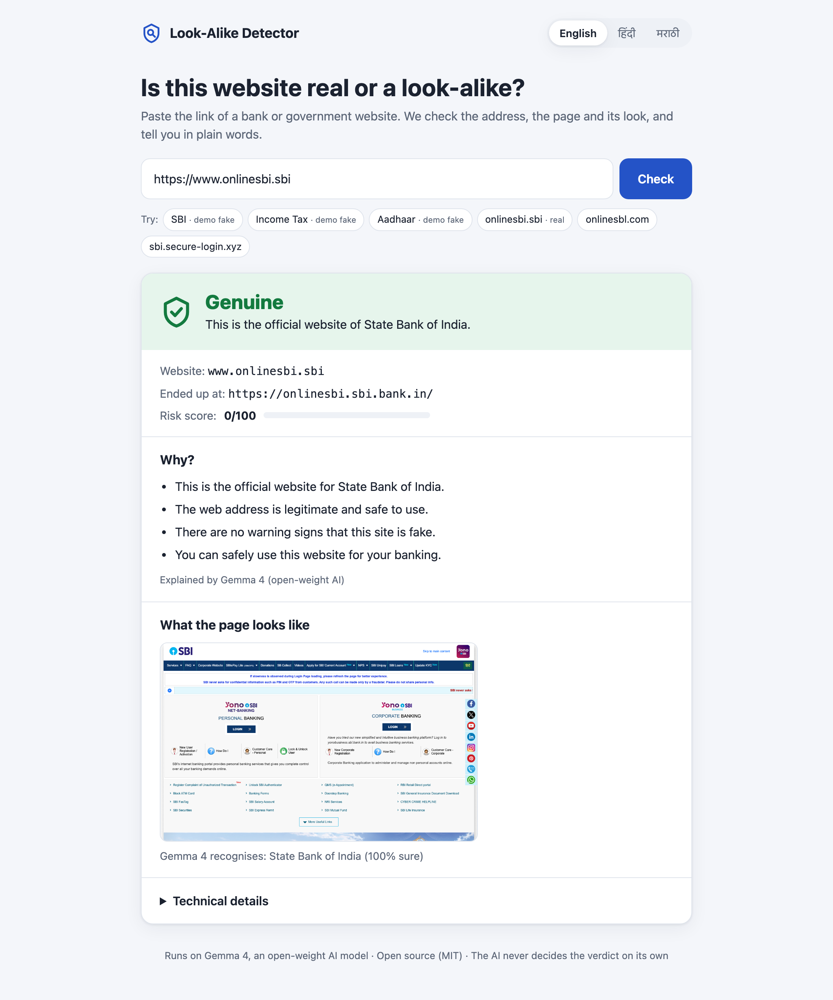
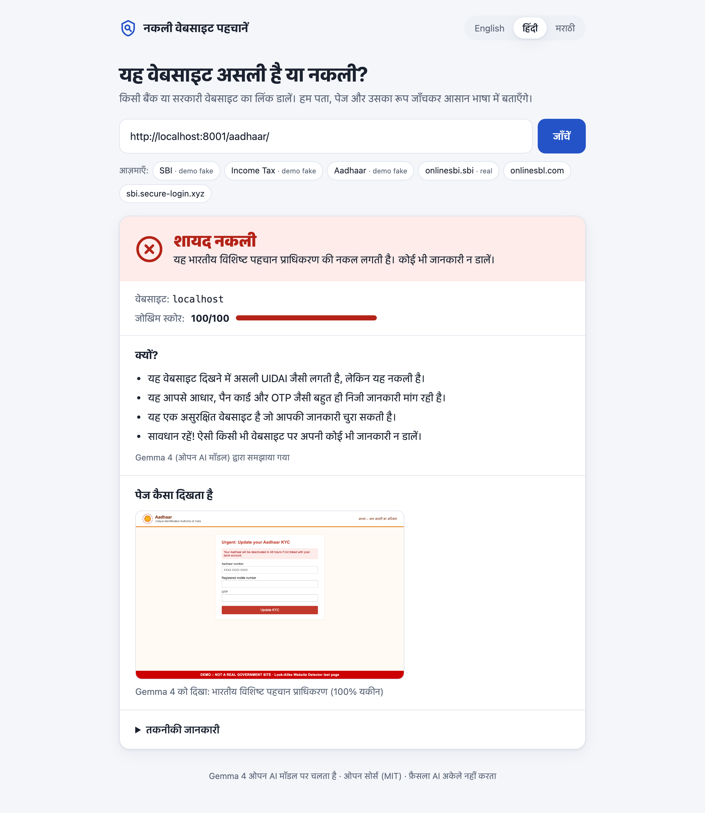
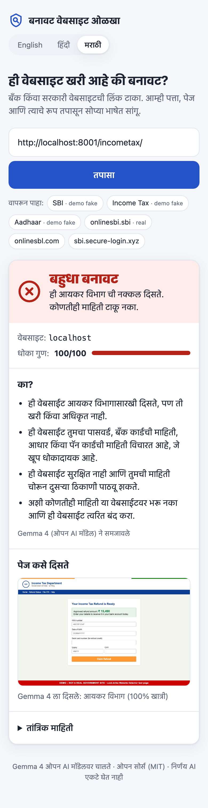

# Look-Alike Website Detector

**Paste a link → find out if it's the real bank or government website or a look-alike, with the warning signs explained in plain English, Hindi or Marathi.**

Built at Hacktoberfest Hack Day (problem statement #10) for the **Main Track: Best Open-Source AI Project**. The AI part runs on **Gemma 4**, Google's open-weight model (Apache 2.0).



## The problem

Fake websites copy the look of Indian banks and government portals (SBI, HDFC, IRCTC, Aadhaar, Income Tax…). The page looks right, so people only notice the wrong web address after they have typed their password, OTP or card number.

## How it works

```
URL ──┬─► 1. Address check  (rules)    onlinesbl.com, sbi.secure-login.xyz, Cyrillic letters, new domain…
      ├─► 2. Page check     (rules)    opens the page: asks for password/OTP/card? form sends data elsewhere?
      └─► 3. Visual check   (Gemma 4)  "this screenshot looks like State Bank of India"
                │
                ▼
          4. Verdict        (rules)    risk score 0–100 → genuine / suspicious / likely fake
                │
                ▼
          5. Explanation    (Gemma 4)  3–5 plain bullets in English, हिंदी or मराठी
```

**The AI never decides the verdict on its own.** Gemma 4 does two jobs: it recognises which brand a screenshot imitates, and it rewrites our findings in simple words. The verdict comes from transparent rules. For example, *"the page looks like SBI **and** the domain is not on SBI's official list"* adds +45 to the risk score. Every signal and its points are visible under "Technical details" in the UI.

### What we check

| Check | Examples of red flags | Points |
|---|---|---|
| **Address** | Look-alike letters (`onlinesbl.com`, `icic1bank.com`, Cyrillic `е`) | +50 |
| | Misspelling (`hdfcbnak.com`), same name with a different ending (`hdfcbank.co`) | +40 |
| | Brand name on someone else's domain (`sbi.secure-login.xyz`, `hdfcbank-kyc.com`) | +40 |
| | `@` trick (`https://www.sbi.co.in@evil.com`), bare IP address | +45 / +40 |
| | Domain registered < 30 days ago (WHOIS) | +35 |
| | No HTTPS, cheap ending like `.xyz` | +15 each |
| **Page** | Form sends your data to another site or an e-mail address | +35 |
| | Invalid security certificate | +35 |
| | Page calls itself a brand it doesn't belong to | +20 |
| | Asks for password / OTP / card / Aadhaar–PAN | +10 to +15 each |
| **Visual (Gemma 4)** | Screenshot looks like a brand, but the domain isn't that brand's | +45 |
| **Official domain** | Host is on the brand's official list ([brands.json](detector/data/brands.json)) | −60 |

Score ≥ 60 → **likely fake**, 25–59 → **suspicious**, < 25 → **genuine**.

**Brands covered:** SBI, HDFC Bank, ICICI Bank, Axis Bank, Kotak, PNB, IRCTC, UIDAI (Aadhaar), Income Tax e-Filing, EPFO. This includes RBI's new `.bank.in` domains and SBI's own `.sbi` ending.

**If a check fails, the others still count.** When WHOIS times out, a site blocks the browser, or the model is unavailable, you still get a verdict from the remaining signals, and the UI lists which check was skipped. If Gemma 4 can't write the explanation, built-in translated sentences are shown instead.

## Screenshots

| Real SBI → genuine | Fake Aadhaar page, in Hindi | Phone, in Marathi |
|---|---|---|
|  |  |  |

## Run it

Needs Python 3.9+ and a free [Gemini API key](https://aistudio.google.com/apikey), which is used to run Gemma 4.

```bash
git clone https://github.com/s28066226-max/lookalike-detector.git
cd lookalike-detector
python3 -m venv .venv && source .venv/bin/activate
pip install -r requirements.txt
python -m playwright install chromium

cp .env.example .env          # then paste your key after GEMINI_API_KEY=
python -m detector --list-models   # optional: shows the Gemma 4 models your key can use
```

Start the demo look-alike pages and the web app in two terminals:

```bash
python -m http.server 8001 --bind 127.0.0.1 --directory demo_sites
python -m detector.server          # open http://127.0.0.1:8000
```

Or use the command line:

```bash
python -m detector https://onlinesbl.com
python -m detector http://localhost:8001/sbi/ --json
python -m detector https://example.com --no-whois --no-page --no-vision   # address check only, offline
```

Run the tests with `pytest`. They need no network and no API key, because the browser and the model are faked.

### Demo pages

[`demo_sites/`](demo_sites/) has three fake pages: an SBI NetBanking login, an Income Tax refund page and an Aadhaar KYC update. **They are served only on localhost.** Each has a red "DEMO – NOT A REAL BANK" footer, and their forms cannot send anything. We never fetch or ship real phishing sites.

## Project layout

```
detector/
  checks/domain.py   address check (deterministic)
  checks/page.py     Playwright screenshot + HTML check (deterministic)
  checks/vision.py   Gemma 4 brand recognition from the screenshot
  analyze.py         runs all checks, collects skipped ones
  verdict.py         risk score → verdict (rules only)
  explain.py         Gemma 4 plain-language bullets + translated fallback text
  llm.py             the one place that calls the model (VISION_BACKEND switch)
  server.py          FastAPI app + JSON API
  data/brands.json   brands → official domains, names, logo hints
web/index.html       single-page UI (vanilla JS, English / हिंदी / मराठी)
demo_sites/          fake look-alike pages for the demo (localhost only)
tests/               pytest suite
```

## Models, tools and libraries

| Name | What we use it for | License |
|---|---|---|
| **Gemma 4** (`gemma-4-26b-a4b-it`) by Google | Brand recognition from screenshots, plain-language explanations | Apache 2.0 (open weights) |
| Gemini API by Google | Hosted access to Gemma 4 | Proprietary service ([Gemini API Terms](https://ai.google.dev/gemini-api/terms)) |
| google-genai | Python client for the Gemini API | Apache 2.0 |
| Playwright + Chromium | Headless browser: open the page, take the screenshot | Apache 2.0 (Playwright), BSD-3-Clause (Chromium) |
| FastAPI / Starlette | Web server and API | MIT / BSD-3-Clause |
| Uvicorn | ASGI server | BSD-3-Clause |
| Pydantic | Request validation | MIT |
| RapidFuzz | Edit distance for misspelled domains | MIT |
| tldextract | Split hosts into subdomain / domain / ending | BSD-3-Clause |
| python-whois | Domain age lookup | MIT |
| Beautiful Soup 4 | Parse the page HTML | MIT |
| httpx | HTTP client (used by the API test client) | BSD-3-Clause |
| python-dotenv | Load settings from `.env` | BSD-3-Clause |
| pytest | Tests | MIT |

This project's own code is released under the [MIT License](LICENSE).

## AI tools used

- **Claude Code** (Anthropic, model Claude Opus 5.5) was used as a coding assistant throughout the build. It wrote the first version of the code, tests, demo pages and this README, following our plan in [CLAUDE.md](CLAUDE.md). The team reviewed, ran and tested everything, and understands all of the code.
- **Gemma 4** is part of the product itself (see above). It is not a development tool.

## Limitations

- **Response time.** The Gemma 4 brand check takes about 10–15 s through the Gemini API. The explanation takes 15–30 s, sometimes more, because Gemma 4 reasons before answering. The UI shows the verdict and a built-in explanation first, then swaps in Gemma's version when it arrives.
- **Some sites block headless browsers.** HDFC, for example, returns 403 to the page check. Those sites are judged on their address alone.
- **The official-domain list is hand-made.** A domain missing from [brands.json](detector/data/brands.json) can be flagged by mistake, and a wrong entry would whitelist a fake. Keep the list short and verified.
- **Local, offline Gemma 4 through Ollama** (`VISION_BACKEND=ollama`) is planned but not built yet.
